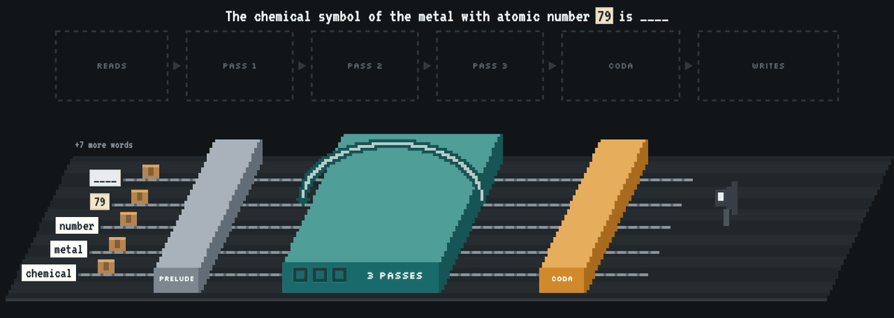

# Looped-transformer Jacobian lens



Code for fitting and reading a per-pass Jacobian lens on [Inkling 2 Mini](https://thinkingmachines.ai/news/inkling-2-mini/), a looped transformer that runs its 12 middle layers three times for every token.

Blog post: [Reading the Loop: Do looped transformers think in words internally?](https://vedantpalit.github.io/blogs/reading-the-loop.html)

## What is here

| file | what it does |
|---|---|
| `inkling_jlens/model.py` | Wraps the Hugging Face model and exposes the residual stream per layer *application* (48 per token: 6 + 3 × 12 + 6), plus the gated messages each pass sends to the next. |
| `inkling_jlens/prepare_corpus.py` | Builds the fitting corpus from WikiText-103 parquet files. |
| `inkling_jlens/fit.py` | Fits the Jacobian lens, J = E[∂h_final / ∂h], for every layer application and every message channel (q, k, v, mlp). `--passes p` fits the exit lens of the model cut to p passes. |
| `inkling_jlens/merge.py` | Merges fit shards into one lens file. |
| `inkling_jlens/readout.py` | Loads a lens and returns lens logits per application (`lens_logits`) and per message (`message_logits`). |
| `inkling_jlens/read.py` | Prints what the lens reads at each word, before the loop, on each pass, and after the loop. |

## Setup

```bash
uv sync    # torch 2.15, transformers 5.24 (the first release with inkling2_loop)
```

The model needs one 80 GB GPU in bf16.

## Fit

```bash
python -m inkling_jlens.prepare_corpus wikitext-103/test.parquet wikitext-103/validation.parquet --out data/prompts.jsonl
# full-model lens (all three passes), sharded over jobs
python -m inkling_jlens.fit --model MODEL_DIR --prompts data/prompts.jsonl --out fits/main --n-prompts 128 --shard 0 --n-shards 4
python -m inkling_jlens.merge fits/main lens_main.pt
# exit lenses for passes 1 and 2 (the model cut after p passes)
python -m inkling_jlens.fit --model MODEL_DIR --prompts data/prompts.jsonl --out fits/p1 --n-prompts 128 --passes 1
python -m inkling_jlens.merge fits/p1 lens_p1.pt
python -m inkling_jlens.fit --model MODEL_DIR --prompts data/prompts.jsonl --out fits/p2 --n-prompts 128 --passes 2
python -m inkling_jlens.merge fits/p2 lens_p2.pt
```

Each pass needs its own lens. The same layer's lens on the first pass is almost unrelated to its lens on the third, because the layers that follow it differ from pass to pass.

## Read

```bash
python -m inkling_jlens.read --model MODEL_DIR --lens lens_main.pt --exit-lenses lens_p1.pt lens_p2.pt \
    --baseline data/prompts.jsonl --prompt "The chemical symbol of the metal with atomic number 79 is"
```

Readings are contrastive when `--baseline` is given: each layer's mean log-probability over ordinary text is subtracted, so words that are always likely do not crowd out the ones specific to the prompt. Many readings inside the loop are in languages other than English.

## Citation

```bibtex
@misc{palit2026readingloop,
  author = {Vedant Palit},
  title  = {Reading the Loop: Do Looped Transformers Think in Words Internally?},
  year   = {2026},
  month  = {nov},
  url    = {https://vedantpalit.github.io/blogs/reading-the-loop.html}
}
```

## License

MIT
